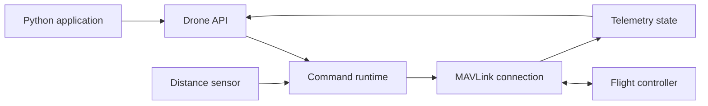

<h1 align="center">Z-Axis</h1>

<p align="center">
  <strong>Autonomous drone control, in Python.</strong><br>
  MAVLink telemetry, flight commands, and onboard workflows in one SDK.
</p>

<p align="center">
  <a href="pyproject.toml"></a>
  <a href="src/zaxis/telemetry/mavlink.py"></a>
  <a href="pyproject.toml"></a>
  <a href="LICENSE"></a>
</p>

<p align="center">
  <a href="#overview">Overview</a> &nbsp;·&nbsp;
  <a href="#installation">Installation</a> &nbsp;·&nbsp;
  <a href="#quick-start">Quick start</a> &nbsp;·&nbsp;
  <a href="#flight-control">Flight control</a> &nbsp;·&nbsp;
  <a href="#contributing">Contributing</a>
</p>

<p align="center">
  
  <br>
  <sub>EletroQuad SAE BRASIL · AXIA Energia · 2026</sub>
</p>

## Overview

Z-Axis is a Python SDK for building autonomous drone applications over MAVLink. It brings vehicle state, flight commands, recurring tasks, and rangefinder integration into a small set of modules, so mission logic can stay in Python.

The flight-control implementation uses ArduPilot-style modes and parameters. Compatibility with other autopilot stacks is not established by this repository.

| Capability | What you can do |
| --- | --- |
| **Flight control** | Set flight modes, arm, take off, navigate, land, and return to launch. |
| **Structured telemetry** | Read position, attitude, GPS, battery, and distance measurements as typed state objects. |
| **Command runtime** | Schedule recurring work and track completion through command handles. |
| **Navigation helpers** | Capture reference origins, send local or global targets, and adjust an origin using supplied image detections. |
| **Rangefinder integration** | Read a Benewake TF-Luna and publish adjusted distance measurements over MAVLink. |
| **Companion interface** | Open an optional browser workspace with terminal and code-editor panels. |

## Installation

Use **Python 3.10 or newer**. The following installs the current repository in editable mode:

```bash
git clone https://github.com/ryancomipsilon/zaxis.git
cd zaxis
python -m venv .venv
```

Activate the environment for your shell:

```bash
# Linux / macOS
source .venv/bin/activate
```

```powershell
# Windows PowerShell
.venv\Scripts\Activate.ps1
```

Then install the SDK and its additional runtime dependencies:

```bash
python -m pip install --upgrade pip
python -m pip install -e . numpy pyserial
```

`pymavlink`, `fastapi`, `uvicorn`, and `websockets` are declared in [pyproject.toml](pyproject.toml). NumPy is imported by the flight-control module, and PySerial provides serial transport and the TF-Luna driver; both are included explicitly above because they are not declared as direct project dependencies.

Verify that the main modules import:

```bash
python -c "from zaxis.drone import Drone; from zaxis.telemetry import MavlinkConnection; print('Z-Axis is ready')"
```

## Quick start

Start a simulator on this computer and configure it to send MAVLink traffic to `127.0.0.1:14550`. Save the following as `telemetry.py` and run it with `python telemetry.py` to print local position. This example requests telemetry and does not issue flight commands.

```python
import time

from zaxis.drone import Drone
from zaxis.telemetry import MavlinkConnection

connection = MavlinkConnection()
connection.connect("udpin:127.0.0.1:14550", baudrate=115200)
drone = Drone(connection)

try:
    while True:
        position = drone.local_position
        if position is not None:
            print(
                f"North: {position.x:.2f} m | "
                f"East: {position.y:.2f} m | "
                f"Down: {position.z:.2f} m"
            )
        time.sleep(0.5)
except KeyboardInterrupt:
    pass
finally:
    drone.runtime.stop()
    connection.connected.clear()
```

`connect()` waits for a vehicle heartbeat and currently has no timeout argument. State fields remain `None` until their corresponding messages arrive. For a serial connection, replace the connection line with your device and configured baud rate, for example:

```python
connection.connect("/dev/ttyTHS1", baudrate=921600)  # Linux UART
# connection.connect("COM3", baudrate=115200)      # Windows serial
```

For incoming UDP traffic from another device, replace `127.0.0.1` with this computer's appropriate network interface address. The `baudrate` argument is required by the SDK even for UDP. Clearing `connection.connected` signals the receiver loop to exit; the current API has no public `disconnect()` method.

## Flight control

`Drone` combines flight controls with access to telemetry and a command runtime. Import modes from `zaxis.control` and use a returned `CommandHandle` to wait for completion:

```python
from zaxis.control import FlightMode

# Insert after Drone(connection), before the telemetry loop.
command = drone.set_mode(FlightMode.GUIDED)
if not command.wait(timeout=10):
    raise RuntimeError("The vehicle did not confirm GUIDED mode.")
```

| Operation | API |
| --- | --- |
| Select a flight mode | `drone.set_mode(FlightMode.GUIDED)` |
| Arm / disarm | `drone.arm()` / `drone.disarm()` |
| Take off to an altitude in meters | `drone.takeoff(altitude)` |
| Navigate using a reference origin | `drone.goto_local(x, y, z, origin=origin)` |
| Move relative to the current position | `drone.goto_offset(x, y, z)` |
| Navigate to a global target | `drone.goto_global(x, y, z)` |
| Send NED / body-frame velocity in m/s | `drone.set_velocity_ned(vx, vy, vz)` / `drone.set_velocity_body(vx, vy, vz)` |
| Land / return to launch | `drone.land()` / `drone.rtl()` |

Available modes are `STABILIZE`, `GUIDED`, `LAND`, `RTL`, `LOITER`, and `AUTO`; the connected vehicle must support the selected mode. Takeoff and origin capture require position and attitude telemetry to be available.

### Command lifecycle

Most flight operations return a handle immediately while work continues in the background:

| Method | Behavior |
| --- | --- |
| `handle.wait(timeout=10)` | Waits up to 10 seconds and returns a Boolean. On timeout, stops the handle and returns `False`. |
| `handle.done()` | Reports whether the handle has finished. |
| `handle.success()` | Reports whether it finished successfully. |
| `handle.stop()` | Stops the handle and invokes its configured cleanup. |

Velocity setters send a single message and return `None`; arrange repeated updates in your application when needed. All `goto_*` operations share one runtime command name, so a new navigation target replaces the previous one. Landing and RTL handles complete when the vehicle is disarmed; stopping a handle does not reverse a flight-mode change.

<details>
<summary><strong>Coordinate conventions and navigation details</strong></summary>

- **NED** means north, east, down. Distances are in meters; positive `z` points downward.
- **FRD** means forward, right, down, relative to a heading.
- `capture_origin()` returns a local origin using the current position and yaw. Pass it to `goto_local()` or assign it to `drone.primary_origin`.
- `goto_local()` interprets `x` and `y` relative to the origin's heading, but `z` is an absolute local NED coordinate. It does not add `origin.z`.
- `goto_offset()` uses offsets from the current position. Its default horizontal frame follows the current heading; `ned=True` uses north/east axes. Its current completion threshold is fixed at `0.05` m, regardless of the `radius` argument.
- `goto_global()` without an origin takes latitude and longitude in degrees as `x` and `y`, and sends `-z` as altitude in meters relative to home. With a global origin, it uses FRD offsets in meters.
- `reanchor()` adjusts the stored horizontal origin using a supplied image detection and camera calibration. Object detection itself is provided by your application.

</details>

## Telemetry

Telemetry is exposed through immutable dataclass snapshots. Read these properties from `drone`, or access the same state through `connection.state`:

| Property | Contents |
| --- | --- |
| `global_position` | Latitude, longitude, altitude, and velocity. |
| `local_position` | NED position and velocity, plus acceleration and covariance when supplied. |
| `attitude` | Quaternion orientation and angular rates. |
| `gps_raw` | Raw GPS position, fix type, and course over ground. |
| `battery` | Voltage, current, and remaining charge when reported. |
| `distance_sensor` | Measured distance, sensor limits, orientation, and covariance. |

For message-level access, register a callback with `connection.on("MESSAGE_TYPE", callback)` and remove it with `connection.off(...)`. Callbacks run on the receiver thread, so keep them short. See the [state definitions](src/zaxis/telemetry/state.py) for field names, units, and optional values.

## Rangefinders

The included TF-Luna driver reads serial measurements in meters. `rngfnd_filter()` applies a configured obstacle-height adjustment and streams `DISTANCE_SENSOR` messages through the drone's runtime.

```python
from zaxis.sensors.benewake.tfluna import TFLuna

# Uses an already connected drone.
sensor = TFLuna(port="/dev/ttyUSB0", baudrate=115200)
try:
    filtering = drone.rngfnd_filter(
        sensor=sensor,
        max_change=0.30,
        obstacle_height=0.70,
        avg_window=10,
        hz=20.0,
    )
    try:
        filtering.wait()  # Keep publishing until interrupted.
    except KeyboardInterrupt:
        pass
    finally:
        drone.runtime.unregister("rngfnd_filter")
finally:
    sensor.close()
```

Custom distance sensors can implement the [`DistanceSensor`](src/zaxis/sensors/base.py) interface: `read()` returns a distance in meters or `None` for an invalid reading, and `close()` releases the device.

## Companion interface

An optional FastAPI interface provides browser panels for a terminal and code editor. Its launcher expects a Linux environment with `sudo`, `bash`, `ttyd`, and `code-server` available on `PATH`; these are separate system tools.

<details>
<summary><strong>Launch and current scope</strong></summary>

After creating a connection, start the interface and keep your application running:

```python
from zaxis.interface.interface import MissionInterface

interface = MissionInterface(connection)
interface.start()
```

The launcher prints its URL and chooses free ports for the interface, terminal, and editor. Use the source installation above so the interface's `index.html` is available.

The telemetry overview, mission dashboard, ROS topics, and camera panels are currently placeholders. The launcher binds services to network-accessible interfaces and starts `code-server` with authentication disabled; keep access restricted to a trusted development network.

</details>

## Architecture



| Module | Responsibility |
| --- | --- |
| [`drone.py`](src/zaxis/drone.py) | Main application-facing API. |
| [`control/`](src/zaxis/control) | Flight commands, navigation, and origin helpers. |
| [`telemetry/`](src/zaxis/telemetry) | MAVLink connection, message parsing, and state snapshots. |
| [`runtime/`](src/zaxis/runtime) | Background command scheduling and completion handles. |
| [`sensors/`](src/zaxis/sensors) | Sensor interface, TF-Luna driver, and rangefinder filter. |
| [`interface/`](src/zaxis/interface) | Optional browser workspace and service launcher. |

## Contributing

Bug reports, documentation improvements, and focused pull requests are welcome. Install the project in editable mode, keep changes scoped, and include a reproducible example and the validation you performed. For hardware-related issues, include the Python version, autopilot firmware, connection type, and relevant logs.

[`src/test.py`](src/test.py) is a hardware integration script with fixed serial devices; it is not an automated test suite. The repository currently includes no automated test suite or CI configuration.

[Report an issue](https://github.com/ryancomipsilon/zaxis/issues) · [Open a pull request](https://github.com/ryancomipsilon/zaxis/pulls)

## License

Z-Axis is released under the [MIT License](LICENSE). Copyright © 2026 Ryan Rocha Moreira.

<p align="center"><a href="#z-axis">Back to top ↑</a></p>
